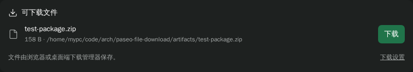

# Paseo file download

[中文说明](README.zh-CN.md)

Download installers, archives and other files from cards below agent replies. File bytes travel over HTTP directly from the Paseo daemon host to the device saving the file.

## Requirements

- Paseo daemon and app 0.15.4 through 0.16.x.
- A direct network path from your device to the download service, normally TCP port 6768.
- Node.js 22+ and npm for development. Runtime production dependencies are installed automatically for Git/npm sources.

## Install

[Listed in the official registry](https://github.com/getpaseo/plugins/pull/2430) as ntr5uki/file-download. Git registry updates are reviewed separately. To select the Paseo 0.16-compatible release directly:

~~~sh
paseo plugin add git:ntr5uki/paseo-file-download --ref v0.2.2
~~~

Linux desktop is the validated target. See the mobile browser/WireGuard limitation under Boundaries.

## Local development and installation

Run these commands in the project directory:

~~~sh
npm ci
npm run check
paseo plugin install "$PWD"
~~~

No download address is required by default. Each device discovers a reachable LAN, Tailscale or local address and verifies that it belongs to the selected daemon before sending a download ticket. Open Settings → Plugins → File downloads → Download settings → Test connection to check this device. Advanced settings contains an optional custom URL, port and listen address. Existing custom URLs are preserved as explicit overrides.

The plugin uses a separate listener; Paseo itself stays on its existing port. Changing the plugin's port or listen address automatically rebinds only this service.

## Use

Ask the agent to link its output, for example:

~~~markdown
[Download installer](dist/setup.exe)
[Download archive](<dist/release package.zip>)
~~~

After the agent finishes, a card lists existing files with their sizes and download buttons. Relative links resolve from the agent's working directory. Absolute paths and local file URLs work when the resulting file is inside its workspace. Reference links work; images, code examples, external URLs and ordinary unlinked filenames do not generate cards. A card contains at most 12 files.

For an earlier reply, run /download without arguments. For a specific file, use /download dist/setup.exe. Paths containing spaces may be quoted. These client commands do not send a prompt to the model. The Command Center also has Add download card for the latest reply and Download settings.

Each click creates a fresh, single-use link with a five-minute lifetime. Browser download handling determines the final save location. Installers over 64 MiB use this HTTP path without the built-in session-transfer cap. The plugin imposes no file-size cap and streams from one open file handle with bounded buffering. Cancel a download using your browser's download controls.

## Automatic discovery

The daemon provides its own IPv4 interface addresses and hostname. This client probes them with a short-lived challenge issued through authenticated Paseo RPC. The expected proof is not sent in probe requests, so another service on the same port cannot pass by echoing the request. Probes contain no file tickets. The selected address is cached only in this app runtime, per host, and verified again on each download. An unreachable cached address triggers another search. Phones and computers can therefore choose different routes to the same host.

This finds a working download route; public Paseo APIs do not expose the current app transport, so the plugin does not claim to identify whether Paseo itself is using direct TCP or relay. Automatic discovery does not create a tunnel or open a blocked port. If the host is reachable only through a relay, NAT mapping or authenticated proxy, set a reachable custom URL in Advanced settings.

## HTTPS and reverse proxies

For a web client on HTTPS, configure an HTTPS custom download URL in Advanced settings to avoid browser mixed-download restrictions. The plugin itself serves HTTP. You can keep the listener on 127.0.0.1 and proxy it, for example with nginx:

~~~nginx
location /paseo-downloads/ {
    proxy_pass http://127.0.0.1:6768/;
    proxy_buffering off;
    proxy_read_timeout 1h;
}
~~~

Set Custom download URL to https://your-host.example/paseo-downloads. The proxy must preserve Content-Disposition and Content-Length. Browser navigation downloads do not require CORS. Discovery proof routes allow anonymous cross-origin reads and private-network preflights; preserve those headers if testing the connection through a proxy. Browser network-access policy may still block automatic HTTP probes on an HTTPS page, while a custom HTTPS URL remains available. Do not log download URL paths at the proxy if you want to keep bearer links out of access logs.

## Boundaries

Files must be non-hidden regular files in the agent's workspace. Path traversal and symlinks leaving that root are rejected. A modified or replaced file invalidates the issued link. There is no unauthenticated file listing: a ticket is created through authenticated Paseo plugin RPC, and authorizes only one file. Anyone who receives a valid link can use it until it expires or is consumed. Tokens stay in memory, are bounded in number, and disappear on reload. The /health route reveals only listener availability.

Cards store file paths, names and sizes, never tokens or file bytes. Auto-cards cover completed replies after the plugin starts; /download can collect the latest historical reply. Card persistence follows Paseo's plugin timeline support. Downloads do not resume with a consumed link; request another one to retry. Linux desktop downloads have also been confirmed by the user. Native mobile renders the plugin UI and opens a system-browser link, but browser downloads have been reported to stall with WireGuard/VPN configurations. The current release targets the validated desktop workflow; general mobile download support remains unverified.

## Maintenance and sharing

The plugin uses public Paseo APIs and has no app-bundle scraping or DOM interception. Update and validate with:

~~~sh
npm run check
paseo plugin reload paseo-file-download
paseo plugin logs paseo-file-download
~~~

A daemon restart is not required. Compatibility is bounded to >=0.15.4 <0.17.0, with daemon and web-client behavior verified on 0.16.0. Test both runtimes before widening paseo-plugin.json further.

Source repository: https://github.com/ntr5uki/paseo-file-download. Install directly with paseo plugin add git:ntr5uki/paseo-file-download. The Git preparation command uses npm ci --omit=dev --ignore-scripts with the committed lockfile. Installing the plugin does not upload workspace files or download content.

The public release uses Git distribution. Before publishing an npm package, remove the Git-only preparation command and ship npm-shrinkwrap.json to lock the installed runtime dependency tree; npm does not publish package-lock.json.

A public Paseo directory listing needs a pinned released commit or npm version. Real light, dark and compact UI screenshots are included in the manifest, along with OVERVIEW.md and its Chinese translation. Choose the repository, validate the exact release, and then submit the listing to https://github.com/getpaseo/plugins.

## Validation

npm run check typechecks both runtimes and exercises real HTTP transfers, including an 80 MiB binary file verified by SHA-256, Unicode filenames, empty files, expired/reused links, changed files, traversal, escaping symlinks, interrupted transfers, and port reuse. Discovery tests cover empty-URL downloads, wrong-host rejection, proof expiry, CORS/private-network preflights, client-local caching, route failover, separate devices, cancellation and custom URL precedence. Markdown parsing is checked separately.

The live UI smoke test verified a real auto-generated card, an empty-URL automatic download with filename/hash checks, cached-address verification, wrong-host rejection and recovery, connection testing, and an optional custom override, with light, dark and 390 px layouts. Downloads, settings and all three layouts were rechecked with the Paseo 0.16.0 daemon and web client, including real LAN and Tailscale routes. To repeat it, use scripts/validate-ui.mjs against a local daemon and an agent in a workspace titled File download plugin containing a card for artifacts/test-package.zip. Set PASEO_TEST_WORKSPACE and PASEO_TEST_AGENT to their IDs. PASEO_TEST_SCREENSHOTS selects the screenshot directory (defaults to assets); use an artifacts subdirectory when not updating published screenshots. PASEO_APP_DIST and PLAYWRIGHT_CHROMIUM_EXECUTABLE can select the local Paseo app build and an installed browser. The harness reads the local daemon credential in memory, without writing it or changing daemon CORS settings.

MIT licensed.
