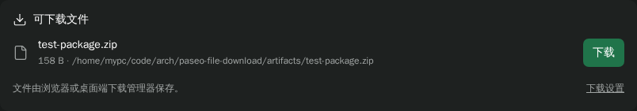

# Paseo 文件下载

在 Agent 回复下方显示文件卡片，直接下载安装包、压缩包和其他文件。文件通过 HTTP 从 daemon 主机流式传输到当前设备。

## 使用

支持 Paseo daemon 和客户端 0.15.4 至 0.15.x。

从公开仓库安装固定版本：

~~~sh
paseo plugin add git:ntr5uki/paseo-file-download --ref v0.2.1
~~~

Linux 桌面下载已验证；手机浏览器在 WireGuard/VPN 场景下仍有已知问题。

开发或安装本地项目：

~~~sh
npm ci
npm run check
paseo plugin install "$PWD"
~~~

默认无需填写下载地址。每台设备会自动寻找可用的局域网、Tailscale 或本机地址，并校验响应确实来自当前选中的 daemon。可以在「设置 → 插件 → 文件下载 → 下载设置」点击「测试连接」，查看当前设备找到的地址。

自定义地址、HTTP 端口和监听范围放在折叠的「高级设置」中。默认监听所有网络接口的 6768 端口。已经填写的自定义地址会继续作为显式覆盖项使用；清空它即可恢复自动检测。

让 Agent 在回复中提供明确链接，例如：

~~~markdown
[下载安装包](dist/setup.exe)
[下载压缩包](<dist/release package.zip>)
~~~

回复完成后自动生成卡片。也可以在输入框使用：

- /download：提取最新回复中的文件链接。
- /download dist/setup.exe：为指定文件生成卡片。
- /download "dist/release package.zip"：指定带空格的路径。

这些客户端命令不会向模型发送消息。命令中心也提供「为最新回复添加下载卡片」和「下载设置」。

## 自动发现

服务端提供本机网卡地址，客户端通过独立的短时身份校验寻找可达地址。探测请求中不包含下载凭证，只有验证正确的地址才会收到文件下载请求。找到的地址缓存在当前客户端，不写入所有设备共享的设置。手机和电脑可以分别使用 Tailscale 与局域网地址；每次下载重新校验缓存，失效后重新寻找。

自动发现验证的是下载服务的可达路径，不会冒充读取 Paseo 当前连接方式。它不会自动建立隧道或开放端口；仅通过中继可达、特殊端口映射或浏览器限制访问 HTTP 时，仍需要在高级设置中指定可达地址。

## 下载行为

点击下载时生成有效期五分钟、仅可使用一次的链接。HTTP 下载采用流式传输，不把整个文件放进前端内存，不受内置会话传输的 64 MiB 上限影响。保存位置和下载进度由浏览器或桌面端下载管理器处理。需要重试时，重新点击卡片中的下载按钮。

默认仅允许下载 Agent 所属工作区内的非隐藏普通文件。目录、隐藏文件、指向工作区外部的符号链接和外部网址会被排除。相对路径基于 Agent 的工作目录解析。普通文字中的裸文件名、图片和代码示例不生成下载卡片，一张卡片最多包含 12 个文件。

Web 客户端通过 HTTPS 使用时，应配置 HTTPS 下载地址。插件本身提供 HTTP，可以通过反向代理提供 HTTPS；配置示例见英文 README。Linux 客户端下载已经由用户确认可用。手机原生客户端可以显示插件界面并在系统浏览器打开链接，但已有 WireGuard/VPN 场景下下载停滞的反馈。当前版本以已验证的桌面流程为主，暂不承诺通用的手机端下载支持。

## 开发维护

~~~sh
npm run check
paseo plugin reload paseo-file-download
paseo plugin logs paseo-file-download
~~~

只需要重载插件，无需重启 Paseo daemon。插件使用公开 API，未使用应用内部对象或界面拦截。版本要求暂时限定为 0.15.x，验证新版后再放宽范围。

测试覆盖 80 MiB 文件完整 SHA-256 校验、二进制原样传输、中文文件名、空文件、链接过期和重复使用、文件变化、路径越界、符号链接、中断下载及端口释放。新增测试覆盖空地址下载、主机身份验证、探测过期、缓存失效、多设备地址选择、取消和手动覆盖。真实 Paseo Web 界面已经验证不填写地址直接下载、缓存校验、错误主机拒绝与恢复、连接测试及高级设置，并检查浅色、深色与 390 像素窄屏。

## 分享

源码仓库为 https://github.com/ntr5uki/paseo-file-download，可以通过 paseo plugin add git:ntr5uki/paseo-file-download 直接安装。Git 安装使用 npm ci --omit=dev --ignore-scripts 和仓库内的锁文件固定生产依赖。

当前公开版本采用 Git 分发。未来若发布到 npm，需要移除仅适用于 Git 的依赖准备命令，并发布 npm-shrinkwrap.json；npm 包不会包含 package-lock.json。

提交到 Paseo 官方插件目录时，需要指定实际仓库和固定版本。项目已包含英文与中文介绍、MIT 许可证和真实界面截图。官方目录是否已收录，以提交审核的 issue 和官方目录状态为准。

下载文件始终从自己的 daemon 主机提供，不会上传到源码仓库、npm 或插件目录。
